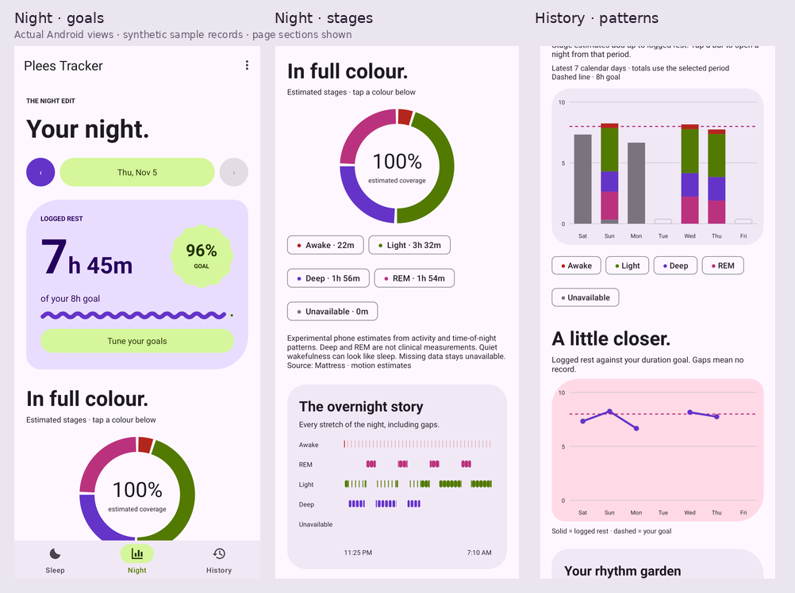

# Plees · Expressive

[](https://github.com/Falconbird18/plees-tracker/actions")

A bold, colorful Material 3 Expressive redesign of [Plees Tracker](https://github.com/vmiklos/plees-tracker), an open-source Android sleep tracker.

- **Sleep:** one oversized Material 3 Expressive sleep/wake button that morphs between the official scalloped Cookie 9 and Sunny shapes.
- **Night:** a coordinated stage ring and overnight timeline, oversized logged-rest numbers, a scalloped goal badge, and bedtime/wake-up comparisons. Pick any recorded rest and every night chart updates together.
- **History:** daily stacked stage bars, goal-versus-logged-rest trends, monthly/yearly averages, a weekly consistency garden, and a scrolling journal. Tap a bar or journal entry to open that night.
- **Editable goals:** duration, bedtime, wake-up time, and 1–7 consistent nights per week. Schedule goals are independent of reminders.
- **Make it yours:** wallpaper-based Material You colors on Android 12+, plus Electric lilac, Sunset coral, and Lagoon blue; light, dark, and system modes.
- **A gentle start:** a skippable three-page introduction and palette selection, replayable from Settings.
- **Expressive throughout:** Material 3 Expressive themes, generous shapes, tonal cards, Material switches, date/time pickers, bottom navigation, and wavy goal progress.

Existing Room data, CSV/calendar import and export, undoable swipe deletion, notes, ratings, wake counts, reminders, DND, Health Connect, automatic folder backups, the home widget, and the quick settings tile are retained. The optional `gplay` flavor retains Google Drive backups; the default `foss` flavor remains free of Google Play services. Migration 5 → 6 retains existing records and adds optional sensor aggregates.

### Phone sleep sensing

Choose mattress motion, nightstand sound levels, or the original sensor-free timer in Settings. Estimated awake/light/deep/REM timelines appear in Night and individual sleep details. These are experimental heuristics, not clinically measured stages. No raw audio is stored. See [sensor behavior, storage, and validation limits](docs-sensor-estimates.md).

### Build

Use JDK 21 and the Android SDK, then run:

```sh
./gradlew assembleFossDebug testFossDebugUnitTest lintFossDebug
./gradlew assembleGplayDebug
```

The minimum Android version remains Android 7 (API 24). Wallpaper colors gracefully fall back to lilac on older devices. Debug APKs use the `.debug` application suffix and can be installed alongside the official app. A self-built APK cannot update an official release signed by another developer; use the existing CSV export/import to transfer records into a separate install.

Google Drive needs your own Android OAuth client configuration, as documented in the [user guide](guide/src/usage.md#google-drive). Health Connect and calendar access remain opt-in.

The test suite covers the existing sleep/data/backup logic plus Material time editing, night selection/restoration, goal persistence and cancellation, midnight/DST calendar math, stage coverage, monthly aggregation, onboarding, and palette fallback. `ExpressiveScreenshotsTest` renders Android views into `app/build/screenshots/` for visual review.

---

Plees Tracker is a simple sleep tracker for your Android phone.

This app is meant to be a simple open source sleep tracker, allowing you to track sleep start/stop times and count the average per day.

Features:
* Simple timer mode does no sensor work overnight. Optional motion and sound-level sensing provide experimental stage estimates and use additional battery.
* Stores past sleeps, counts stat from them.
* Exports/imports sleep data to/from CSV.
* Can show past sleeps, can selectively delete individual sleeps.




Check out the [user guide](https://vmiklos.hu/plees-tracker/) for a full list of features, 
installation, and usage information.


## Contributing
plees-tracker is free and open source. You can view the source code, file an issue, or request new features. 
If you'd like to contribute, please consider opening a pull request.

## License

Use of this source code is governed by a BSD-style license that can be found in the LICENSE file.


## Get it on F-Droid:
[](https://f-droid.org/en/packages/hu.vmiklos.plees_tracker/)